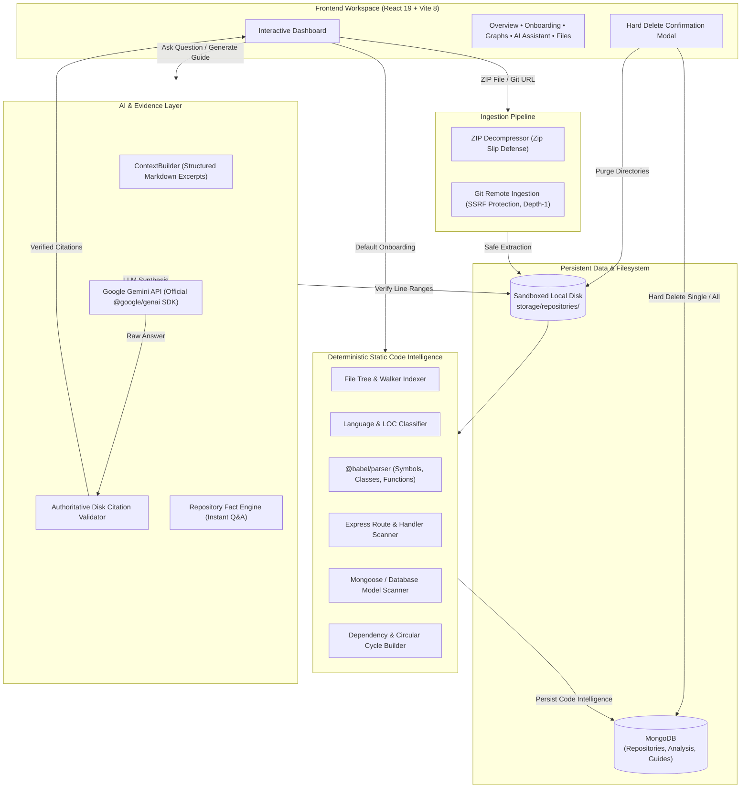

# 🔍 RepoLens — Instant Codebase Understanding for Every Developer

<p align="center">
  
</p>

<p align="center">
  <a href="#-features"></a>
  <a href="#-features"></a>
  <a href="#-features"></a>
  <a href="#-features"></a>
  <a href="#-features"></a>
  <a href="#-features"></a>
  <a href="#-automated-testing"></a>
  <a href="#-security-architecture"></a>
</p>

---

## 📖 Table of Contents

- [What is RepoLens?](#-what-is-repolens)
- [The Problem vs. The RepoLens Solution](#-the-problem-vs-the-repolens-solution)
- [Key Features](#-key-features)
  - [1. Safe & Resilient Ingestion](#1-safe--resilient-ingestion)
  - [2. Deep Static Code Intelligence (AST)](#2-deep-static-code-intelligence-ast)
  - [3. Instant Default & AI-Powered Onboarding Guides](#3-instant-default--ai-powered-onboarding-guides)
  - [4. Evidence-Grounded AI Codebase Assistant](#4-evidence-grounded-ai-codebase-assistant)
  - [5. Interactive Architecture & Execution Flow Graphs](#5-interactive-architecture--execution-flow-graphs)
  - [6. Complete Hard Delete & Storage Lifecycle](#6-complete-hard-delete--storage-lifecycle)
- [System Architecture](#-system-architecture)
- [Technology Stack](#-technology-stack)
- [Project Directory Structure](#-project-directory-structure)
- [Quick Start Guide](#-quick-start-guide)
- [API Reference](#-api-reference)
- [Automated Testing Suite](#-automated-testing-suite)
- [Security & Grounding Guarantees](#-security--grounding-guarantees)

---

## 💡 What is RepoLens?

**RepoLens** is an open-source, evidence-grounded code intelligence platform that helps software engineers, open-source contributors, and tech leads understand unfamiliar repositories **instantly**.

Instead of spending hours manually clicking through nested folders, deciphering complex import graphs, guessing application entry points, or risking security vulnerabilities by running untrusted scripts, **RepoLens gives you immediate, visual, and architectural clarity in seconds**.

RepoLens combines **deterministic static code analysis** (AST parsing, manifest inspection, import dependency topology) with **Google Gemini AI reasoning**. Every explanation, suggested file, and AI claim is strictly anchored to verified file paths and exact line numbers.

---

## ⚡ The Problem vs. The RepoLens Solution

| The Traditional Struggle | The RepoLens Advantage |
| :--- | :--- |
| **Days spent onboarding:** Digging through READMEs that are outdated or incomplete. | **Instant Default Onboarding:** Immediately extracts languages, entry points, reading sequence, and run commands. |
| **Confusing project layout:** Jumping between dozens of files to trace where execution starts. | **Deterministic Entry Point & Graph Mapping:** Visualizes execution flows from route -> controller -> database. |
| **AI hallucinations:** Generic LLMs invent fake file paths, phantom dependencies, and incorrect line numbers. | **Evidence-Grounded RAG:** Every claim is cited with verified snippets, line ranges, and authoritative validation. |
| **Security risks:** Running unfamiliar code locally just to see how it works. | **Zero Code Execution:** Completely safe static analysis. RepoLens never compiles, executes, or runs user code. |
| **Cluttered storage & zombie test data:** Unused repositories lingering in storage and databases. | **Thorough Hard Deletion:** Cascades across MongoDB, disk storage, and browser local storage with zero remnants. |

---

## ✨ Key Features

### 1. Safe & Resilient Ingestion
- **ZIP Archive Uploads:** Drag-and-drop or file select with strict 25MB limits and built-in **ZIP Slip path traversal defense**.
- **Public Git Remote Imports:** Clone public repositories from GitHub, GitLab, or Bitbucket with SSRF (Server-Side Request Forgery) protection, private IP blocking, and shallow `--depth 1` single-branch cloning.
- **Hierarchical File Explorer:** Fast file tree navigation with search, extension filters, and line-numbered code viewer.

### 2. Deep Static Code Intelligence (AST)
- **Language Detection & LOC:** Automatic calculation of language breakdown percentages and code volume.
- **Abstract Syntax Tree (AST) Parsing:** Powered by `@babel/parser` for JavaScript/TypeScript to extract exported functions, async handlers, React components, classes, methods, and parameters.
- **Express Route & Handler Mapping:** Automatically discovers REST API routes (`GET`, `POST`, `PUT`, `DELETE`, etc.), parameter bindings, middleware chains, and handler functions.
- **Database Schema & Query Inspection:** Detects Mongoose schemas, models, and database operations (`find`, `create`, `update`, `delete`, `aggregate`) without touching the database.
- **Import Dependency Graph & Cycle Detection:** Traces internal module imports, maps external npm/pip packages, and flags circular dependency loops.

### 3. Instant Default & AI-Powered Onboarding Guides
- **Instant Default Onboarding Screen:** Even before or without generating an AI guide, RepoLens presents an evidence-backed overview:
  - Repository metrics (total files, source type, code size, detected languages)
  - Categorized framework stack (Frontend, Backend, Database ODM, Build tools)
  - Application starting points (`server.js`, `main.jsx`, `app.py`) with direct code inspection links
  - Recommended initial reading order prioritizing documentation, manifests, entry files, configs, and routers
  - Discovered quick start terminal commands (`npm install`, `npm run dev`) with one-click copy buttons
  - Statically discovered API endpoints table
- **Deep AI Onboarding Guide (Powered by Gemini):**
  - Synthesizes comprehensive architecture overviews and core component responsibilities
  - Generates safe local setup commands with verification badges and warnings
  - Creates environment variable checklists with automatic redaction of sensitive credentials (`JWT_SECRET`, database passwords)
  - Identifies common setup pitfalls and evidence-backed troubleshooting steps

### 4. Evidence-Grounded AI Codebase Assistant
- **Quick Repository Fact Q&A:** Instant, deterministic answers grounded in static code intelligence for common questions:
  - *"How many files and what is the project structure?"*
  - *"Which major technologies and frameworks are used?"*
  - *"What is the starting point or main entry point of this project?"*
  - *"What package dependencies does this project rely on?"*
  - *"What API routes or endpoints are defined in this repository?"*
- **Authoritative Citation & Claim Verification:** Gemini synthesizes answers, but a strict server-side validator cross-checks every line citation and file path against the actual files on disk. Fabricated claims are stripped or downgraded to inferences.
- **Interactive Citation Viewer:** Clicking any citation in the chat highlights the exact source lines in the code viewer.
- **Offline Platform FAQ Knowledge Base:** 15+ built-in architectural and platform FAQs available even when offline or unconfigured.

### 5. Interactive Architecture & Execution Flow Graphs
- Built with **React Flow (`@xyflow/react`)** featuring pan, zoom, minimap, search, and category filters.
- **4 Distinct Graph Perspectives:**
  1. **Module Dependency Graph:** File-to-file imports, entry points, and circular dependency cycle warnings.
  2. **API Request Flow Graph:** Tracing incoming HTTP routes to controller handlers and database persistence layers.
  3. **Function & Call Graph:** AST-extracted symbol definitions, caller-callee links, and exported method nodes.
  4. **Database Interaction Graph:** Models, schemas, and queries connected to the routes that invoke them.
- **Bidirectional Deep-Linking:** Inspect any node in the code viewer or deep-link directly into the AI Assistant.

### 6. Complete Hard Delete & Storage Lifecycle
- **Individual Repository Hard Deletion:** Permanently purges the repository record, associated `AnalysisResult` knowledge bases, generated `OnboardingGuide` documents, the disk directory in `storage/repositories`, and browser `localStorage`.
- **Bulk "Delete All" Action:** Easily clean the entire workspace in one click.
- **Windows Permission Resilient:** Recursive permission unsetting (`chmod`) and retry mechanisms ensure Git packfiles (`.git/objects`) and locked files are removed cleanly without `EPERM` or `EACCES` errors.

---

## 🏗️ System Architecture



---

## 💻 Technology Stack

| Layer | Technologies |
| :--- | :--- |
| **Frontend Core** | React 19, JavaScript (ES Modules), Vite 8, React Router DOM v7 |
| **UI & Styling** | Custom Git-Dark Design Tokens (`variables.css`), Bootstrap 5, React Icons (`react-icons/vsc`), React Hot Toast |
| **Motion & Animation** | Motion (`motion/react` v12) |
| **Graph Visualization** | React Flow (`@xyflow/react`) |
| **Backend API** | Node.js (v24+), Express.js 5, Multer 2, CORS, Helmet, Morgan, Express Rate Limit |
| **AST & File Processing** | `@babel/parser`, `adm-zip`, custom recursive file walk and path safety validators |
| **Database** | MongoDB with Mongoose 9 ODM |
| **AI Reasoning** | Google Gemini (`gemini-3.8-flash`) via the official `@google/genai` SDK |
| **Dev Tooling** | Concurrently, Nodemon, ESLint |

---

## 📂 Project Directory Structure

```text
RepoLens/
├── client/                               # Frontend Single Page Application
│   ├── src/
│   │   ├── components/
│   │   │   ├── intelligence/             # Code intelligence tabs
│   │   │   │   ├── OverviewTab.jsx       # Repository architecture overview & stats
│   │   │   │   ├── AiAssistantTab.jsx    # Evidence-grounded Gemini Q&A with quick chips
│   │   │   │   ├── SymbolsTab.jsx        # Searchable AST symbols, functions & classes
│   │   │   │   ├── DependenciesTab.jsx   # Internal imports & external package dependencies
│   │   │   │   ├── EndpointsTab.jsx      # Discovered HTTP routes & handlers
│   │   │   │   ├── DatabaseTab.jsx       # Database models, schemas & query operations
│   │   │   │   └── AiContextTab.jsx      # Prepared Markdown context inspector
│   │   │   ├── onboarding/               # Onboarding workspace
│   │   │   │   ├── OnboardingDashboard.jsx   # Main onboarding container & stale tracker
│   │   │   │   ├── OnboardingEmptyState.jsx  # Instant default onboarding screen from file data
│   │   │   │   ├── OnboardingSection.jsx     # Collapsible motion section component
│   │   │   │   ├── SetupCommand.jsx          # Terminal command cards with copy buttons
│   │   │   │   ├── EnvironmentVariableList.jsx # Redacted environment variable list
│   │   │   │   ├── RecommendedFileList.jsx   # Initial reading order sequence stepper
│   │   │   │   └── EvidenceCitation.jsx      # Authoritative code snippets & file links
│   │   │   ├── visualization/            # React Flow interactive graphs
│   │   │   │   ├── GraphWorkspace.jsx    # Interactive canvas with pan, zoom & minimap
│   │   │   │   ├── GraphToolbar.jsx      # Graph selector, search & category filters
│   │   │   │   ├── GraphLegend.jsx       # Node types & circular cycle indicators
│   │   │   │   ├── GraphDetailsPanel.jsx # Node details, citations & deep links
│   │   │   │   └── CustomGraphNode.jsx   # Styled dark Git node cards
│   │   │   ├── DashboardHeader.jsx       # Hero header with analyze CTA
│   │   │   ├── DeleteRepositoryModal.jsx # Accessible single & bulk hard delete modal
│   │   │   ├── FileExplorer.jsx          # Hierarchical file tree with filter & search
│   │   │   ├── FileViewer.jsx            # Monospace viewer with line highlighting
│   │   │   ├── RepositoryImportPanel.jsx # ZIP upload dropzone & Git URL input
│   │   │   ├── RepositoryResultsView.jsx # Tabbed intelligence workspace
│   │   │   ├── Sidebar.jsx               # Repositories list & "Delete All" action
│   │   │   └── StatusBanner.jsx          # Contextual notifications
│   │   ├── layouts/MainLayout.jsx        # Shell layout with header & toast container
│   │   ├── pages/Dashboard.jsx           # Primary application dashboard
│   │   ├── services/api.js               # Axios client & browser localStorage manager
│   │   ├── styles/variables.css          # Central color palette, radii & transitions
│   │   ├── App.jsx                       # Root routing & backend health monitor
│   │   └── main.jsx                      # Vite React entry point
│   ├── .env.example                      # Client environment template
│   └── package.json
├── server/                               # Backend REST API & Code Intelligence Engine
│   ├── src/
│   │   ├── config/
│   │   │   ├── env.js                    # Environment variable parser & validation
│   │   │   ├── db.js                     # MongoDB connection & readiness tracker
│   │   │   └── storage.js                # Sandboxed storage & robust cleanup helpers
│   │   ├── controllers/
│   │   │   └── repository.controller.js  # Ingestion, inspection, deletion & analysis controllers
│   │   ├── models/
│   │   │   ├── Repository.js             # Metadata, language stats & file tree
│   │   │   ├── AnalysisResult.js         # Symbols, routes, models, dependencies & graphs
│   │   │   └── OnboardingGuide.js        # Synthesized guides, reading orders & commands
│   │   ├── routes/
│   │   │   ├── health.routes.js          # Health check endpoint
│   │   │   └── repository.routes.js      # REST API route declarations
│   │   ├── services/
│   │   │   ├── code-intelligence/        # Core static analysis & AI services
│   │   │   │   ├── repositoryAnalyzer.js # Pipeline coordinator
│   │   │   │   ├── repositoryFactAnswer.js # Instant Q&A engine for basic repository facts
│   │   │   │   ├── languageDetector.js   # Language composition & LOC calculator
│   │   │   │   ├── frameworkDetector.js  # Framework detection (Express, React, Mongoose, etc.)
│   │   │   │   ├── entryPointDetector.js # Server & frontend mount detector
│   │   │   │   ├── symbolExtractor.js    # AST function, class & method extractor
│   │   │   │   ├── apiAnalyzer.js        # Express route & handler extractor
│   │   │   │   ├── databaseAnalyzer.js   # Database schema & query extractor
│   │   │   │   ├── dependencyAnalyzer.js # Import graph & external package mapper
│   │   │   │   ├── relationshipBuilder.js# Dependency graph & circular cycle detector
│   │   │   │   ├── contextBuilder.js     # Structured Markdown evidence builder
│   │   │   │   ├── qaRetrieval.service.js# AST & metadata evidence retrieval
│   │   │   │   ├── qaValidator.js        # Authoritative line citation & claim validator
│   │   │   │   ├── qaService.js          # Grounded prompt coordinator with Gemini
│   │   │   │   ├── suggestedQuestions.service.js # Dynamic feature-grounded question generator
│   │   │   │   ├── graphBuilder.js       # Topological graph coordinate calculator
│   │   │   │   └── onboardingService.js  # Onboarding evidence synthesis & guide builder
│   │   │   ├── zipIngestion.service.js   # Safe ZIP extraction & Zip Slip defense
│   │   │   ├── gitIngestion.service.js   # Safe Git clone with SSRF defense
│   │   │   ├── fileIndexer.service.js    # Recursive directory walker & tree generator
│   │   │   └── gemini.service.js         # Official @google/genai SDK service wrapper
│   │   ├── utils/
│   │   │   ├── pathSafety.js             # Path traversal prevention & binary heuristics
│   │   │   └── languageDetector.js       # Extension mapping & syntax classification
│   │   ├── app.js                        # Express middleware & router mounting
│   │   └── server.js                     # HTTP listener & graceful shutdown
│   ├── test/                             # Automated verification suites
│   │   ├── ingestion.test.js             # Ingestion & path safety test suite
│   │   ├── analysis.test.js              # AST & code intelligence test suite
│   │   ├── qa.test.js                    # Grounded Q&A & citation test suite
│   │   ├── graph.test.js                 # React Flow graph topology test suite
│   │   ├── onboarding.test.js            # Onboarding guide & setup test suite
│   │   ├── deletion_and_faq.test.js      # Hard delete & offline FAQ test suite
│   │   └── run_all.js                    # Master test runner with automated test cleanup
│   ├── .env.example                      # Server environment template
│   └── package.json
├── docs/
│   ├── architecture.md                   # In-depth architectural specification
│   └── demo-guide.md                     # Live demonstration walkthrough
├── AGENTS.md                             # Architectural standards & security guidelines
└── package.json                          # Monorepo scripts via concurrently
```

---

## 🚀 Quick Start Guide

### Prerequisites

- **Node.js:** v20.x or higher (v24 recommended)
- **npm:** v10.x or higher
- **MongoDB:** Community Edition running locally (`mongodb://127.0.0.1:27017`) or a MongoDB Atlas URI
- **Git:** Installed and available in your system `PATH`
- **Google Gemini API Key:** *(Optional for static analysis and default onboarding; required for AI-synthesized deep guides and freeform Q&A)*. Get a free key at [Google AI Studio](https://aistudio.google.com/).

---

### Step 1: Clone & Install Dependencies

```bash
# Clone the repository
git clone https://github.com/your-username/RepoLens.git
cd RepoLens

# Install all root, frontend, and backend dependencies
npm run install:all
```

---

### Step 2: Configure Environment Variables

```bash
# Setup Frontend environment
cp client/.env.example client/.env

# Setup Backend environment
cp server/.env.example server/.env
```

**`server/.env` Configuration:**
```dotenv
PORT=5000
NODE_ENV=development
CLIENT_URL=http://localhost:5173
MONGODB_URI=mongodb://127.0.0.1:27017/repolens
GEMINI_API_KEY=your_gemini_api_key_here
GEMINI_MODEL=gemini-3.8-flash
```

> **Note:** If `GEMINI_API_KEY` is omitted, RepoLens continues to operate in **deterministic static mode** with full AST parsing, file exploration, instant default onboarding, graph visualizations, and offline FAQ answers.

---

### Step 3: Run the Development Server

```bash
npm run dev
```

This starts both servers simultaneously via `concurrently`:
- **Frontend Dashboard:** [http://localhost:5173](http://localhost:5173)
- **Backend API:** [http://localhost:5000](http://localhost:5000)
- **Health Check:** [http://localhost:5000/api/health](http://localhost:5000/api/health)

---

### Step 4: Analyze Your First Repository

1. Open [http://localhost:5173](http://localhost:5173).
2. Either:
   - **Upload a ZIP file** (up to 25MB) of any JavaScript/TypeScript, Python, or Web project.
   - **Import a public Git URL** (e.g. `https://github.com/octocat/Hello-World`).
3. RepoLens extracts and analyzes the repository in milliseconds.
4. Explore the **Overview**, **Onboarding Guide**, **Architecture Graphs**, and **AI Assistant** tabs!

---

## 📡 API Reference

### System Health
| Method | Endpoint | Description |
| :--- | :--- | :--- |
| `GET` | `/api/health` | Returns service status, MongoDB connectivity, and Gemini AI status |

### Repository Ingestion & Lifecycle
| Method | Endpoint | Description |
| :--- | :--- | :--- |
| `POST` | `/api/repositories/upload` | Ingests a `.zip` archive (multipart `file`, optional `name`) |
| `POST` | `/api/repositories/import` | Ingests a public Git repository (`{ "url": "https://github.com/..." }`) |
| `GET` | `/api/repositories` | Lists recent repositories (supports `?limit=100`) |
| `GET` | `/api/repositories/:id` | Returns full metadata, total files, and language stats |
| `DELETE` | `/api/repositories/:id` | **Hard deletes** a repository, its analysis, guides, and disk storage |
| `DELETE` | `/api/repositories` | **Hard deletes ALL** repositories, analysis results, and disk directories |
| `GET` | `/api/repositories/faq` | Returns predefined platform FAQs for offline help |

### File Inspection
| Method | Endpoint | Description |
| :--- | :--- | :--- |
| `GET` | `/api/repositories/:id/tree` | Returns recursive nested file tree |
| `GET` | `/api/repositories/:id/files` | Returns flat list of indexable files (`?query=`, `?language=`) |
| `GET` | `/api/repositories/:id/file?path=...` | Returns safe file content with total lines |

### Code Intelligence (AST & Topology)
| Method | Endpoint | Description |
| :--- | :--- | :--- |
| `POST` | `/api/repositories/:id/analyze` | Executes or reruns static code intelligence |
| `GET` | `/api/repositories/:id/analysis` | Retrieves complete analysis results |
| `GET` | `/api/repositories/:id/symbols` | Returns AST functions, classes, and methods (`?query=`, `?type=`) |
| `GET` | `/api/repositories/:id/dependencies` | Returns internal import graph & external package declarations |
| `GET` | `/api/repositories/:id/endpoints` | Returns discovered Express API routes & handlers |
| `GET` | `/api/repositories/:id/database-interactions` | Returns database models, schemas, and queries |
| `GET` | `/api/repositories/:id/context` | Returns structured Markdown context prepared for Gemini AI |

### Grounded Q&A Assistant
| Method | Endpoint | Description |
| :--- | :--- | :--- |
| `POST` | `/api/repositories/:id/ask` | Natural language Q&A grounded in verified code evidence |
| `GET` | `/api/repositories/:id/suggested-questions` | Returns dynamic questions tailored to repository features |

### Interactive Architecture Graphs
| Method | Endpoint | Description |
| :--- | :--- | :--- |
| `GET` | `/api/repositories/:id/graph?type=modules` | React Flow module dependency graph with cycle detection |
| `GET` | `/api/repositories/:id/graph?type=api-flow` | API execution flow graph (Route -> Handler -> Database) |
| `GET` | `/api/repositories/:id/graph?type=call-graph` | Function and method call graph with AST line ranges |
| `GET` | `/api/repositories/:id/graph?type=database` | Database interaction graph linking endpoints to models |

### Onboarding & Setup Assistant
| Method | Endpoint | Description |
| :--- | :--- | :--- |
| `GET` | `/api/repositories/:id/onboarding` | Returns cached onboarding guide or staleness flag |
| `POST` | `/api/repositories/:id/onboarding/generate` | Synthesizes an evidence-backed onboarding guide with Gemini |
| `POST` | `/api/repositories/:id/onboarding/regenerate` | Forces regeneration with the latest code analysis |

---

## 🧪 Automated Testing Suite

RepoLens includes a comprehensive, end-to-end automated testing suite with **142 test cases across 6 distinct suites**:

```bash
# Run all automated tests
npm test
```

### Test Suites Included:
1. **`ingestion.test.js`**: Health checks, non-zip upload rejection, ZIP Slip directory traversal attacks, Git shallow clone, SSRF protection, and file path safety.
2. **`analysis.test.js`**: Framework classification, entry point detection, AST symbol extraction (`@babel/parser`), Express route parsing, Mongoose schema detection, and import dependency mapping.
3. **`qa.test.js`**: Evidence retrieval, endpoint queries, database model retrieval, cross-repo isolation, unconfigured/offline Gemini handling, timeout handling, and authoritative citation verification.
4. **`graph.test.js`**: Topological sorting, circular dependency cycle detection, node positioning, and 4 React Flow graph formats.
5. **`onboarding.test.js`**: Setup command verification, environment variable checklist parsing, secret redaction, reading order generation, and guide staleness invalidation.
6. **`deletion_and_faq.test.js`**: Single repository cascading hard delete, bulk hard deletion (`DELETE /api/repositories`), disk cleanup verification, and offline FAQ matching.

> **Clean Test Guarantee:** The test runner automatically purges all temporary test fixtures from MongoDB and disk storage after completion.

---

## 🛡️ Security & Grounding Guarantees

- **Zero Code Execution:** RepoLens is a static analysis and AI reasoning engine, **not an execution sandbox**. Uploaded and cloned code is never run, compiled, or evaluated (`eval`).
- **Prompt Injection Defense:** Repository files, comments, READMEs, docstrings, and configuration files are treated strictly as untrusted raw data, never as prompt instructions to the Gemini model.
- **Path Traversal & ZIP Slip Protection:** All archive entries and file requests are validated using `assertSafePath` to prevent directory traversal (`../`) outside the sandboxed repository root.
- **SSRF Defense:** Git clone URLs are validated against approved hosting providers (GitHub, GitLab, Bitbucket), credentials in URLs are rejected, and hostname DNS is resolved to block access to private or loopback IP ranges (`127.0.0.1`, `10.0.0.0/8`, `192.168.0.0/16`, cloud metadata `169.254.169.254`).
- **Credential & Secret Redaction:** Environment checklists automatically redact sensitive keys (`JWT_SECRET`, database passwords, private keys) before presenting them in the UI or passing them to the AI model.
- **Clean Storage Policy:** Hard deletion cascades through MongoDB collections, wipes physical directories with Windows permission resilience, and clears browser local storage.

---

## 📄 License

This project is licensed under the [ISC License](LICENSE).

---

<p align="center">
  <b>RepoLens</b> — Give Every Developer Instant Codebase Understanding.
</p>
