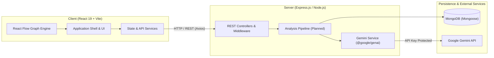
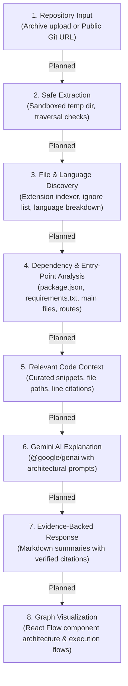

# RepoLens Architecture & Technical Specification

> **Give Every Developer Instant Codebase Understanding**  
> Track: Code Intelligence | Architecture & Execution Flow Engine

---

## 1. System Overview

RepoLens is a full-stack MERN application augmented with Google Gemini to help software engineers rapidly understand unfamiliar codebases. The system combines deterministic static analysis (manifest parsing, file trees, entry point mapping) with AI-powered architectural reasoning and interactive React Flow visualization.



---

## 2. Frontend / Backend Boundary

| Aspect | Frontend (`client/`) | Backend (`server/`) |
| :--- | :--- | :--- |
| **Technology** | React 19, Vite, Bootstrap 5, React Flow (`@xyflow/react`) | Node.js (v24+), Express 5, Mongoose |
| **Styling** | Git-inspired dark theme, CSS custom properties (`variables.css`) | N/A |
| **Secrets & Keys** | None. Only public config (`VITE_API_BASE_URL`) | `GEMINI_API_KEY`, `MONGODB_URI` isolated |
| **Analysis Execution**| Graph rendering, zoom/pan interaction, markdown rendering | Path validation, static extraction, Gemini context construction |
| **Error Handling** | React Hot Toast, status banners, error boundaries | Centralized Express error handler, uniform JSON error contracts |

---

## 3. Environment & Configuration Architecture

Configuration is strictly separated across tiers:

```text
RepoLens/
├── client/
│   ├── .env.example        # VITE_API_BASE_URL=http://localhost:5000/api
│   └── .env                # Local client override (git-ignored)
└── server/
    ├── .env.example        # PORT, NODE_ENV, CLIENT_URL, MONGODB_URI, GEMINI_API_KEY, GEMINI_MODEL
    └── .env                # Local backend secrets (git-ignored)
```

- **Client Environment**: Only variables prefixed with `VITE_` are bundled. **Under no circumstances should `GEMINI_API_KEY` or MongoDB connection strings exist in client environments**.
- **Server Environment**: Loaded synchronously at process startup via `server/src/config/env.js`. Access to `process.env` is wrapped in immutable configuration exports.
- **Conditional Database Connection**: If `MONGODB_URI` is blank or unset, the server starts cleanly in standalone mode while reporting `not_configured` in `/api/health`.

---

## 4. Backend Service Organization

```text
server/src/
├── config/
│   ├── env.js             # Environment parsing, defaults, and feature flag checks
│   └── db.js              # Mongoose connection manager and live status reporter
├── controllers/           # HTTP route handlers (Planned: analysis, repos, queries)
├── middleware/
│   ├── errorHandler.js    # Uniform error response normalizer
│   └── notFoundHandler.js   # 404 API route catcher
├── models/                # Mongoose database schemas (Planned: Repository, AnalysisResult)
├── routes/
│   └── health.routes.js   # /api/health endpoint
├── services/
│   └── gemini.service.js  # Official @google/genai service layer with safety guards
├── utils/                 # Path sanitizers, formatters, and parsing helpers
├── app.js                 # Express application definition, security headers, middleware
└── server.js              # Network listener, database connection bootstrap, graceful shutdown
```

---

## 5. Repository Analysis Pipeline

The core repository comprehension engine processes codebases through a structured, multi-stage pipeline designed for security, deterministic accuracy, and token economy:



### Stage Breakdown & Implementation Status

| Stage | Name | Status | Description |
| :---: | :--- | :---: | :--- |
| **1** | **Repository Input** | *Planned (Stage 2)* | Ingest repository zip archives or clone public Git URLs via depth-1 fetch. |
| **2** | **Safe Extraction** | *Planned (Stage 2)* | Unpack files into isolated temporary directories; prevent path traversal (`../`) and reject binaries or files exceeding size thresholds. |
| **3** | **Language & File Discovery** | *Planned (Stage 2)* | Build repository file tree, calculate file sizes, determine language composition, and detect build tooling. |
| **4** | **Dependency & Entry Points** | *Planned (Stage 3)* | Deterministically parse manifest files (`package.json`, `pom.xml`, `go.mod`, etc.) and identify core servers, routers, and client mounts. |
| **5** | **Relevant Code Context** | *Planned (Stage 3)* | Extract precise code excerpts preserving exact file paths and line ranges. Avoid indiscriminate repository dumps into AI context. |
| **6** | **Gemini Explanation** | *Foundation Ready* | Backend service initialized with `@google/genai`. Ready to send curated context and receive structured architectural reasoning. |
| **7** | **Evidence-Backed Response** | *Planned (Stage 4)* | Format responses with clickable line citations and verify claims against static facts. |
| **8** | **React Flow Visualization** | *Foundation Ready* | `@xyflow/react` installed in client. Ready to render component trees, data pipelines, and request-response pathways. |

---

## 6. Security & Execution Boundaries

1. **Zero Execution Policy**: RepoLens never compiles, executes, or runs tests on analyzed codebases. All analysis is strictly static and interpretive.
2. **Untrusted Content Sanitization**: Any repository content, docstrings, or markdown instructions are treated as untrusted strings, never as instructions to the AI agent.
3. **Network Isolation**: The client communicates solely through the reverse proxy or defined backend API origin. The frontend has zero direct connection to MongoDB or the Google Gemini API.
