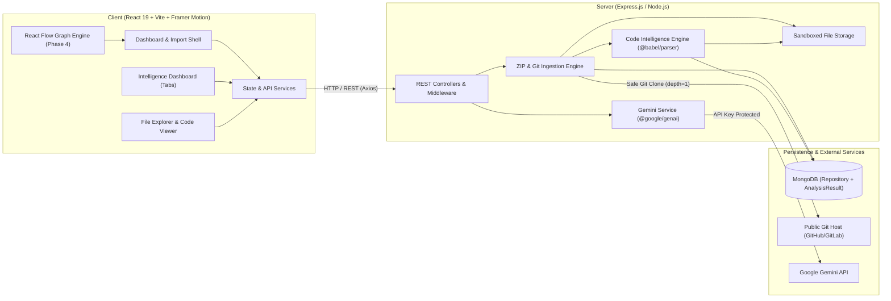
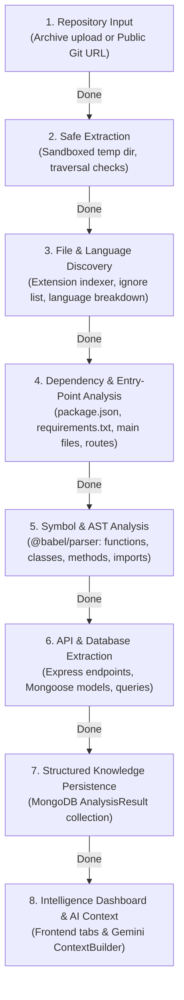
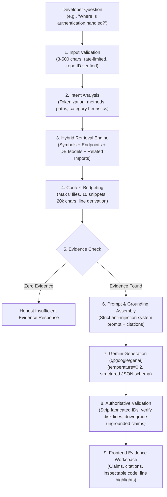

# RepoLens Architecture & Technical Specification

> **Give Every Developer Instant Codebase Understanding**  
> Track: Code Intelligence | Architecture & Execution Flow Engine

---

## 1. System Overview

RepoLens is a full-stack MERN application augmented with Google Gemini to help software engineers rapidly understand unfamiliar codebases. The system combines deterministic static analysis (manifest parsing, file trees, entry point mapping, AST parsing, API detection, and database model extraction) with AI-powered architectural reasoning and interactive React Flow visualization.



---

## 2. Frontend / Backend Boundary

| Aspect | Frontend (`client/`) | Backend (`server/`) |
| :--- | :--- | :--- |
| **Technology** | React 19, Vite, Bootstrap 5, Motion (`motion/react`), React Flow (`@xyflow/react`) | Node.js (v24+), Express 5, Mongoose, Multer, Adm-Zip, `@babel/parser` |
| **Styling** | Git-inspired dark theme, CSS custom properties (`variables.css`) | N/A |
| **Secrets & Keys** | None. Only public config (`VITE_API_BASE_URL`) | `GEMINI_API_KEY`, `MONGODB_URI` isolated |
| **Intelligence UI** | Overview, Symbols, Dependencies, Endpoints, Database, AI Context tabs | Static AST extraction, Express route scanner, Mongoose schema analyzer, graph cycle detection |
| **Error Handling** | React Hot Toast, animated banners, form validation | Centralized Express error handler, uniform JSON error contracts |

---

## 3. Environment & Configuration Architecture

Configuration is strictly separated across tiers:

```text
RepoLens/
├── client/
│   ├── .env.example        # VITE_API_BASE_URL=http://localhost:5000/api
│   └── .env                # Local client override (git-ignored)
└── server/
    ├── .env.example        # PORT, NODE_ENV, CLIENT_URL, MONGODB_URI, GEMINI_API_KEY, GEMINI_MODEL
    └── .env                # Local backend secrets (git-ignored)
```

- **Client Environment**: Only variables prefixed with `VITE_` are bundled.
- **Server Environment**: Loaded synchronously at process startup via `server/src/config/env.js`.
- **Database Connection**: MongoDB is configured via `MONGODB_URI` (defaults to `mongodb://127.0.0.1:27017/repolens`).

---

## 4. Backend Service Organization

```text
server/src/
├── config/
│   ├── env.js                     # Environment parsing, defaults, and feature flags
│   ├── db.js                      # Mongoose connection manager and live status reporter
│   └── storage.js                 # Sandboxed filesystem storage configuration
├── controllers/
│   └── repository.controller.js   # Handlers for ingestion, tree, files, and code intelligence
├── middleware/
│   ├── errorHandler.js            # Uniform error response normalizer
│   └── notFoundHandler.js         # 404 API route catcher
├── models/
│   ├── Repository.js              # Repository metadata & raw file index
│   └── AnalysisResult.js          # Persistent code intelligence results, symbols, and dependencies
├── routes/
│   ├── health.routes.js           # /api/health endpoint
│   └── repository.routes.js       # /api/repositories/* endpoints
├── services/
│   ├── code-intelligence/
│   │   ├── repositoryAnalyzer.js  # Pipeline coordinator & orchestrator
│   │   ├── languageDetector.js    # Language stats, LOC, source code classifier
│   │   ├── frameworkDetector.js   # Manifest & heuristic framework identifier
│   │   ├── entryPointDetector.js  # Application servers & mount hooks detector
│   │   ├── symbolExtractor.js     # AST-based symbol & method extractor (@babel/parser)
│   │   ├── apiAnalyzer.js         # Express route & handler analyzer
│   │   ├── databaseAnalyzer.js    # Mongoose, Prisma, Sequelize schema & query detector
│   │   ├── dependencyAnalyzer.js  # Internal vs external import mapper & usage counter
│   │   ├── relationshipBuilder.js # File-level dependency graph & cycle detector
│   │   ├── contextBuilder.js      # Structured Markdown evidence builder for Gemini AI
│   │   ├── qaRetrieval.service.js # Hybrid metadata & bounded AST evidence retrieval (Phase 4)
│   │   ├── qaValidator.js         # Authoritative claim and citation verification engine (Phase 4)
│   │   ├── qaService.js           # Grounded Q&A prompt builder & Gemini orchestrator (Phase 4)
│   │   └── suggestedQuestions.service.js # Dynamic feature-grounded question generator (Phase 4)
│   ├── zipIngestion.service.js    # ZIP Slip defense & archive decompression
│   ├── gitIngestion.service.js    # SSRF validation & depth-1 public Git clone
│   ├── fileIndexer.service.js     # File walker & hierarchical tree builder
│   └── gemini.service.js          # Official @google/genai service layer with safety guards
├── utils/
│   ├── pathSafety.js              # Path traversal assertions & binary file detector
│   └── languageDetector.js        # File extension classifier
├── app.js                         # Express application definition & middleware
└── server.js                      # Network listener & startup bootstrap
```

---

## 5. Repository Analysis Pipeline



### Stage Breakdown & Implementation Status

| Stage | Name | Status | Description |
| :---: | :--- | :---: | :--- |
| **1** | **Repository Input** | **Completed (Phase 2)** | Ingest repository ZIP archives (drag & drop, 25MB limit) or public Git repository HTTPS URLs. |
| **2** | **Safe Extraction** | **Completed (Phase 2)** | Pre-scan ZIP entries for ZIP Slip attacks (`../`), reject symbolic links, enforce uncompressed size thresholds, isolate in sandboxed storage directory. |
| **3** | **Language & File Discovery** | **Completed (Phase 2)** | Build navigable tree, filter out build artifacts (`node_modules`, `dist`), detect programming languages, compute composition percentages. |
| **4** | **Dependency & Entry Points** | **Completed (Phase 3)** | Deterministically parse manifest files (`package.json`, `requirements.txt`), detect application servers, startup scripts, and frontend mounts. |
| **5** | **Symbol & AST Analysis** | **Completed (Phase 3)** | Parse JS/TS/JSX/TSX AST with `@babel/parser`. Extract functions, arrow functions, classes, methods, parameters, line numbers, and exports. |
| **6** | **API & Database Extraction** | **Completed (Phase 3)** | Identify Express `app.*` and `router.*` endpoints with handlers and prefixes; detect Mongoose schemas, models, and query patterns. |
| **7** | **Relationship Graph & Cycles** | **Completed (Phase 3)** | Build file-to-file import graph, detect circular dependencies using DFS cycle detection, and match declared dependencies with source code usage. |
| **8** | **AI Context Builder** | **Completed (Phase 3)** | High-density structured Markdown prompt context generator preserving verified file paths and line ranges for Gemini AI. |

---

## 6. Security & Execution Boundaries

1. **Zero Execution Policy**: RepoLens never compiles, executes, or runs tests on analyzed codebases. All analysis is strictly static and interpretive.
2. **ZIP Slip & Path Traversal Guards**: Every archive entry and file retrieval path is validated against `assertSafePath` to guarantee it cannot escape the sandboxed storage root.
3. **SSRF Defense**: Git URLs are restricted to HTTPS protocol and approved hosts (`github.com`, `gitlab.com`, `bitbucket.org`). DNS resolution rejects private IP ranges, loopback, and link-local cloud metadata endpoints.
4. **Shell Injection Defense**: Git clone is invoked strictly via `child_process.spawn('git', args, { shell: false })` with environment credentials stripped.
5. **AST Parse Recovery**: Malformed code files are handled gracefully via `@babel/parser` error recovery and recorded in `warnings` without crashing the analysis.

---

## 7. Phase 4: Gemini Codebase Q&A & Evidence Grounding Engine

### 7.1 Architecture & Retrieval Workflow

RepoLens implements a hybrid code retrieval architecture grounded in deterministic static analysis rather than a generic vector database. Because source code requires exact file paths, line numbers, symbol hierarchies, and route connections, RepoLens retrieves targeted context directly from its MongoDB code intelligence index and verified disk excerpts.



### 7.2 Retrieval Strategy & Scoring

The retrieval engine (`qaRetrieval.service.js`) combines several matching channels:
1. **Exact & Substring Symbol Matching**: AST-extracted function, class, and method names (+80 to +95 points).
2. **Declared HTTP Endpoint Matching**: Express HTTP methods and paths (+60 to +90 points).
3. **Database Interaction Matching**: Mongoose models, operations (`query`, `create`, `update`), and schemas (+45 to +85 points).
4. **Dependency Graph Expansion**: When an endpoint or symbol is matched, internal import edges are traversed to depth 1 (e.g. `routes/auth.routes.js` -> `controllers/auth.controller.js` -> `models/User.js`).
5. **Configuration & Manifest Matching**: Environment templates (`.env.example`), `package.json`, and entry points (+50 to +65 points).

### 7.3 Context Budget Enforcement

To prevent LLM context pollution and protect latency, strict boundaries are enforced:
- **Maximum retrieved files**: 8 files.
- **Maximum snippets per question**: 10 bounded excerpts.
- **Maximum context characters**: 20,000 characters (~5,000 tokens).
- **Maximum snippet size**: 60 lines with 2 context padding lines before and after.
- **Overlapping range merging**: Overlapping or adjacent snippet ranges within the same file are merged into unified blocks to maximize information density.

### 7.4 Authoritative Citation & Claim Validation

The backend (`qaValidator.js`) serves as the single source of truth for citations:
- Gemini returns claims referencing evidence IDs (`ev_1`, `ev_2`, ...).
- **Unknown Evidence ID Removal**: Any citation ID not in the backend's provided evidence map is stripped immediately.
- **Fact vs. Inference Verification**: If a claim is labeled `source_fact` but has zero verified evidence citations remaining, it is downgraded to `architectural_inference`.
- **Disk Line Clamping**: Every referenced line range is verified against the actual line count of the file on disk. Stale or out-of-bounds line numbers are clamped to actual file lengths.
- **Suggested File Filtering**: Every recommended file in `suggestedFiles` must exist in `repository.fileList`; fabricated file paths are purged.

### 7.5 Gemini Configuration

- Set `GEMINI_API_KEY` in `server/.env`.
- Optionally configure `GEMINI_MODEL` (defaults to `gemini-2.5-flash`).
- When `GEMINI_API_KEY` is omitted, the API responds with a structured `503 Service Unavailable` error and detailed troubleshooting advice.

